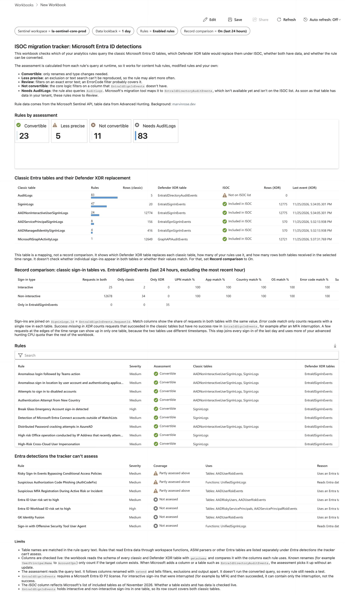

# ISOC migration tracker

A workbook for the Microsoft Defender portal that shows which of your Microsoft Sentinel analytics rules depend on the classic Microsoft Entra ID tables, which Defender XDR table would replace each one under ISOC, and whether the rule can be converted.

Background and lab findings on [marvinrose.dev](https://marvinrose.dev).

## What it shows

- **Rules by assessment**: every enabled Scheduled and NRT rule that queries `SigninLogs`, `AADNonInteractiveUserSignInLogs`, `AADServicePrincipalSignInLogs`, `AADManagedIdentitySignInLogs`, `AuditLogs` or `MicrosoftGraphActivityLogs`, grouped by how hard the conversion is.
- **Classic Entra tables and their Defender XDR replacement**: the target table per classic table, whether it's on the ISOC list, how many of your rules use it and how many rows both tables received.
- **Record comparison** (optional): joins the classic sign-in tables with `EntraIdSignInEvents` for the last day and shows coverage, matching values and successful sign-ins that are missing in Defender XDR.
- **Rules**: one row per rule with its assessment, source and target tables, data status and a note on what to change.
- **Entra detections the tracker can't assess**: rules that read Entra data through workspace functions, ASIM parsers or Entra tables without a mapped Defender XDR table.

## How the assessment works

Everything is calculated at runtime from your own rules and tables, so it works for content hub rules, modified rules and your own detections.

1. The rule list comes from the Microsoft Sentinel API (`alertRules`), the list of workspace functions from `savedSearches`.
2. The workbook reads the schema of every classic and Defender XDR table with `getschema`.
3. For each rule it compares the columns the query uses with the schema of the target table. Known renames, for example `UserPrincipalName` to `AccountUpn` or `ResultType` to `ErrorCode`, only count if the target column exists.
4. It checks how a missing column is used: in a filter, in an exclusion or only in the output. Columns renamed with `extend` are followed.

| Assessment | Meaning |
|---|---|
| Convertible | Only renames and type changes needed. |
| Less precise | An exclusion or text search can't be reproduced, so the rule may alert more often. |
| Review | Filters on an exact error text; an `ErrorCode` filter probably covers it. |
| Not convertible | The core logic filters on a column the target table doesn't have. |
| Needs AuditLogs | The rule also queries `AuditLogs`. Microsoft's migration tool maps it to `EntraIdDirectoryAuditEvents`, which isn't available yet and isn't on the ISOC list. As soon as that table has data in your tenant, these rules are assessed against its schema. |

When Microsoft adds a column or a table, the assessment picks it up on the next run without an update to the workbook.

## Requirements

- Microsoft Sentinel connected to the Microsoft Defender portal.
- Read access to the Sentinel workspace (analytics rules and saved searches) and access to Advanced hunting.
- `EntraIdSignInEvents` requires a Microsoft Entra ID P2 license.

## Installation

1. In the Defender portal, open [Workbooks](https://security.microsoft.com/workbooks) and select **Add**.
2. In the new workbook, select **Advanced editor**.
3. Replace the content with [`isoc-migration-tracker.workbook.json`](isoc-migration-tracker.workbook.json) and select **Apply**.
4. Select **Done Editing**, pick your Sentinel workspace and save the workbook.

## Parameters

| Parameter | Default | Description |
|---|---|---|
| Sentinel workspace | none | The workspace whose rules and tables are checked. |
| Data lookback | 1 day | Time range for row counts. |
| Rules | Enabled rules | Enabled rules only or all rules. |
| Record comparison | Off | Joins the sign-in tables record by record for the last day. |

## Limits

- Table names are matched in the rule query text. Rules that read Entra data through workspace functions, ASIM parsers or other Entra tables are listed separately and aren't assessed.
- The assessment doesn't run the converted query. Test every rule before you switch.
- The ISOC column reflects Microsoft's list of included tables as of November 2026. Whether a table exists and has data is checked live.
- For interactive sign-ins that were interrupted (for example by MFA) and then succeeded, `EntraIdSignInEvents` can contain only the interruption, not the success.
- All queries run in Advanced hunting and count toward its CPU quota, which is shared by everyone in the tenant. In large environments, keep the lookback short and leave Record comparison off unless you need it. If a step shows HTTP 429, wait for the next quota cycle.
- Very large rule sets can exceed the request size of Advanced hunting (HTTP 413).
